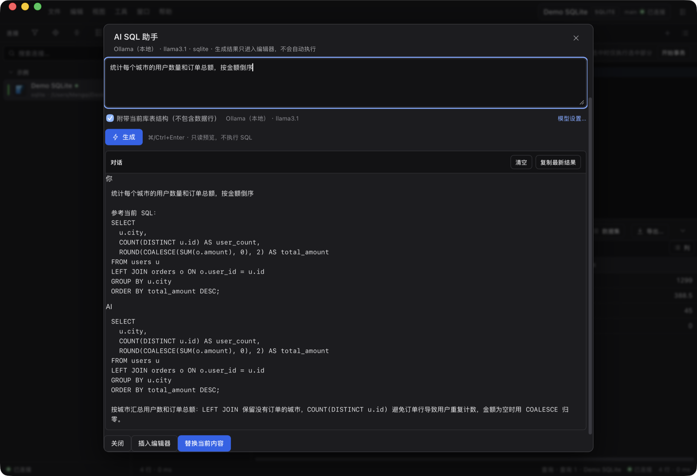
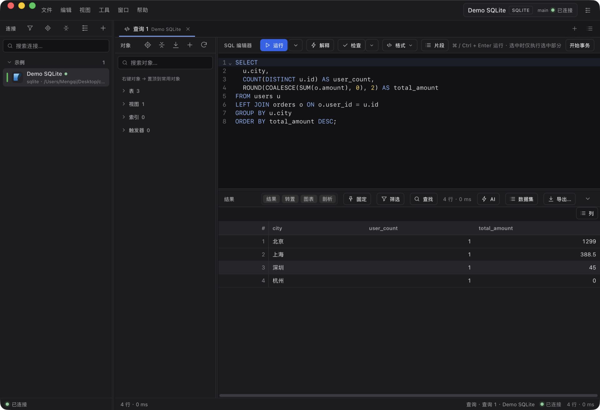

# mydb

轻量、跨平台的数据库客户端。当前是 **v0.13.0**：支持 SQLite / MySQL / PostgreSQL / MongoDB / Redis、SSH 隧道与 Redis TLS、MySQL 库级与 PostgreSQL 模式级对象树、统一的查询 / 表 / ER 多标签、结果固定与对比、结果剖析、表数据与结构视图、结构同步与行级数据同步、手动事务、新建表设计器、数据导入和执行历史。

技术栈参考 [DBX](https://github.com/t8y2/dbx)：**Tauri 2 + Rust + Vue 3 + TypeScript**，SQL 编辑器使用 CodeMirror 6，数据库访问使用 SQLx。

界面按 DBX 的暗色工作台风格对齐：自定义 Overlay 标题栏、窗口内文本菜单栏、连接 chip、连接/对象搜索、表标签、数据/结构分段控件、紧凑数据网格和深色模态框；仅参考视觉语言，不复制其品牌资源。

版本变更记录见 [CHANGELOG.md](CHANGELOG.md)；版本号只在明确要求时提升。

## 界面截图

### AI SQL 助手



### AI 生成 SQL 并执行



## 当前功能

- **SQLite**、**MySQL / MariaDB**、**PostgreSQL**、**MongoDB** 与 **Redis** 连接；MongoDB 支持单 host 字段表单和 `mongodb://` / `mongodb+srv://` 完整连接串（多 host、副本集与 URI 参数）
- 连接的新建、编辑、删除，配置持久化到应用配置目录
- MySQL 支持 host / port / user / password / 可选默认数据库 / SSL 模式；SSL 支持禁用、优先、必须、verify-ca、verify-full，并可指定 CA 与客户端证书 / 私钥；不填数据库时自动连接 `mysql` 系统库
- MySQL 对象浏览器按「数据库 → 表 / 视图 / 存储过程 / 函数 / 触发器 / 事件 / 序列 → 字段」展开；每类对象都会显示数量（包括 0）。连接建立后一次性读取全部数据库的对象与数量，切换数据库不会重连。
- PostgreSQL 对象浏览器按「数据库 → 模式 → 表 / 视图 / 物化视图 / 存储过程 / 函数 / 触发器 / 序列 → 字段」展开；可在模式间切换，SQL 编辑器中的非限定语句会跟随当前模式（`search_path`）
- **连接与分组**：左侧连接 / 分组右键菜单支持打开 / 刷新对象、新建查询、关闭连接、编辑、复制连接（可选复制已保存密码）、复制连接信息（URL / 主机:端口 / JDBC / DSN / 命令行 / 含密码 URL，含密码需二次确认）、只读模式、移动到分组、删除；分组支持新建 / 重命名 / 删除、连接全部 / 断开全部；分组元数据保存在 `groups.json`
- **只读连接**：连接可标记为只读，命令层拒绝写入（SQL 只允许 SELECT/SHOW/DESCRIBE/EXPLAIN/PRAGMA，禁止多语句与 `RETURNING` 绕过），Redis 写命令与 MongoDB 插入 / 替换 / 删除 / 建索引同样被拒绝
- **危险 SQL 确认**：默认对缺少 WHERE 的 UPDATE / DELETE、DROP、TRUNCATE、ALTER TABLE ... DROP COLUMN/CONSTRAINT 弹出二次确认；高危语句需勾选不可恢复提示。可在编辑菜单关闭，字符串 / 注释中的关键字不会误触发
- **设置中心**：`⌘/Ctrl+,` 打开，支持深色 / 浅色 / 跟随系统主题、SQL 编辑器字号、运行按钮默认范围（当前语句 / 整个标签）、危险 SQL 确认、格式化设置入口和版本信息；设置保存在本机，重启恢复
- **对象右键菜单**：表 / 视图 / 物化视图可打开数据、查看结构、在新标签打开、生成 SQL（SELECT / INSERT / UPDATE / DELETE / DDL，直接在查询标签打开）、复制 DDL / 名称 / 带引号限定名、导出、重命名、删除、刷新；表支持「复制为新表」（结构 + 全部数据）、清空表 / 截断表；视图支持「复制为新视图」和「快照为新表」（可选是否包含数据）；存储过程 / 函数 / 触发器 / 事件 / 序列 / 索引按当前驱动能力提供复制 DDL、重命名与删除；数据库和模式节点提供切换、新建表、刷新、复制名称；表右键支持「导入数据」（CSV / JSON）
- **对象树多选**：表 / 视图 / 例程行支持复选框、⌘/Ctrl 点击与 Shift 范围选择；批量操作栏可导出选中对象 DDL、刷新、清空 / 截断表或删除对象，写入前二次确认并列出对象名，失败停止后可继续剩余对象
- SQLite 对象树同样固定显示表 / 视图 / 索引 / 触发器及各自数量
- **SQL 脚本**：多语句标签显示「脚本模式（N 条）」并可开启「多语句出错继续」与「脚本事务包裹」，逐条保留结果并统计成功 / 失败 / 未执行与总耗时；事务失败整体回滚，成功一次提交，已有手动事务不自动提交。
- **SQL 参数**：查询编辑器支持 `:name` 与 SQLite / MySQL 单语句 `?`，运行 / 解释前填写字符串、数字、布尔、NULL 或经确认的原始 SQL；参数值只保留在当前标签会话，执行历史保存原始模板，不保存参数值。
- **AI 助手**：SQL 查询工具栏、MongoDB 工作区、Redis 键面板 / 命令控制台均提供「AI」，可生成 / 解释 / 优化 / 修复 SQL、Redis 命令和 mongosh 命令，并支持多轮追问；设置中心配置 Claude、OpenAI、DeepSeek、Ollama 或自定义 OpenAI 兼容服务，API Key 存钥匙串，生成结果只进入编辑器不自动执行，默认不发送结果行。
- **SQL 用户授权**：服务器活动 → 用户 / 角色可生成并执行 MySQL / PostgreSQL 的 GRANT / REVOKE，支持全局 / 库 / 模式 / 表范围和白名单权限；只读连接禁用。
- **列定位与空列隐藏**：查询结果 / 表数据新增列面板，可按列名或注释搜索列，手动显示 / 隐藏，或按「全 NULL」「全 NULL / 空串」自动隐藏空列；自动隐藏为会话状态，不写入命名视图。
- **数据集与报表**：查询结果面板的「数据集」可保存当前结果快照（本地 localStorage）、打开原 SQL 重跑，或导出带打印样式的独立 HTML 报表；报表只反映保存时快照。
- **列显示格式**：查询结果与表数据列头右键可为日期 / 数字 / JSON 路径 / 脱敏 / 模板设置显示规则，列头显示 `fx`；只改变网格显示与查找文本，复制原始值、编辑、筛选、统计、图表和导出仍使用原始值。查询结果规则只保留在当前结果会话，表数据规则按连接 / 库 / 表持久化到 `mydb.columnFormatters.v1`。
- **MongoDB 工作区**：连接支持 host / port、用户名 / 密码、认证数据库（authSource）、TLS、SSH 隧道与只读模式，也支持 URI / SRV 连接方式；URI 模式的多 host、`replicaSet`、`tlsCAFile`、`readPreference`、`retryWrites` 等参数由 MongoDB 驱动解析，完整连接串只保存在钥匙串，`connections.json` 仅保留脱敏地址，URI 模式不使用 SSH 隧道；工作区左侧按数据库列出集合 / 视图并支持搜索、新建 / 删除 / 重命名集合、集合统计与数据库新建 / 删除、用户与角色管理，右侧按动态字段展示文档，支持双击标量单元格待提交编辑、标记删除与 `updateOne` / `deleteOne` 预览；新增 GridFS 模式，可浏览 bucket、上传 / 下载 / 删除文件，支持 JSON 筛选 / 投影 / 排序、分页与总数、文档 JSON 查看 / 插入 / 替换 / 删除、只读 aggregation pipeline、命令式查询控制台（`use` / `show`、find / findOne / count / distinct / aggregate、单条 CRUD 与常用状态命令，Extended JSON、补全、历史和写安全确认）、JSON / CSV 批量导入与导出，以及索引列表 / 创建 / 删除。文档使用 MongoDB Extended JSON 展示与编辑（如 `{"$oid":"..."}`），编辑时保持 `_id` 不变；不提供 SQL 编辑器。
- Redis 支持 host / port / 可选用户名 / 密码 / 数据库编号，以及 **SSH 隧道**和 **TLS**（对话框中选择「必须使用（TLS）」后按 `rediss` 连接）；左侧 SCAN 键列表支持游标「加载更多」、模式匹配与逻辑库切换，右侧查看 string / hash / list / set / zset / stream，并支持 TTL 设置 / 永久、重命名（覆盖确认）、string 值编辑、hash 字段增删改、list 左右插入 / 按索引修改 / 按值删除、set 成员增删、zset score 修改与成员增删；可删除键并执行任意 Redis 命令；工作区和状态栏显示当前数据库编号（如 `db01`）；主页面 `dbNN` 徽标可点击展开逻辑库下拉框，列表显示各库键数量，选中后立即切换并在重连后保持所选库；检测到 Redis Cluster 时下拉框里只包含 `db00`；控制台标签可关闭，关闭后回到「主工作区」，点标签栏 `+` 或重新选择连接恢复
- 数据库密码可选保存到系统钥匙串（macOS Keychain / Windows Credential Manager / Linux Secret Service）；不勾选时仅当前运行有效
- MySQL / PostgreSQL / MongoDB / Redis 支持 **SSH 隧道**：私钥或密码认证，私钥可填写口令并保存到系统钥匙串（独立凭据），首次连接自动写入 `~/.ssh/known_hosts`（TOFU），之后检测主机密钥变化
- 连接分组与颜色标记
- 左侧连接列表 + 分层对象浏览器（数据库 / 表 / 视图 / 存储过程 / 函数 / 字段）；支持搜索、方向键 / Home / End / Enter 键盘导航、右键菜单；表 / 视图可右键「置顶到常用对象」，顶部「常用对象」区按连接 + 库 / 模式展示快捷入口（本地保存、最多 50 个、随搜索过滤、失效对象自动隐藏）；点击 SQLite 索引节点会打开所属表的结构并高亮该索引
- CodeMirror SQL 编辑器，按连接驱动自动切换 MySQL / PostgreSQL / SQLite 方言，并提供当前库 / 模式下的表名与字段补全（`Ctrl+Space` 手动唤起）；`⌘ / Ctrl + Enter` 运行，有选区时只执行选中 SQL，无选区时按设置执行光标所在语句（默认）或整个标签；运行按钮下拉可临时选择范围，多语句时显示「第 N / M 条」
- **统一标签栏**：查询、表 / 视图和 ER 图共用同一条标签栏并按打开顺序排列，可以同时打开多个表（每个表标签记录所属连接与数据库 / 模式，并可分别切换数据 / 结构）；标签支持拖动排序、固定到左侧（固定标签不参与关闭其他 / 右侧 / 全部）、右键菜单和「全部标签」溢出菜单，查询标签顺序与固定状态重启恢复；切换标签会自动切换连接上下文（MySQL `switch_database`、PostgreSQL `switch_database` + `switch_schema`），目标连接有未提交事务且需要换库 / 模式时阻止切换；同一对象再次打开会复用已有标签，右键「在新标签打开」则总是新开一个；`Ctrl + Tab` 在全部标签间循环
- **右侧分屏与多窗口**：查询标签右键「在右侧分屏打开」得到可编辑的第二查询工作区（编辑器、运行 / 停止 / 解释、事务与结果导出），左侧保持当前查询；如果分屏的是当前标签，会自动新建一个同来源查询并复制 SQL，左右可独立执行。表 / ER 标签仍以只读分屏打开。查询标签右键「在新窗口打开」会创建独立原生查询窗口，隐藏侧栏和对象树，拥有自己的标签、结果和事务，不覆盖主窗口的标签 / 布局存储；中间分隔条可拖动、双击重置
- **查询标签**：每个标签记录所属连接和数据库 / 模式（例如 `mysql · app`），切换数据源不会改写已有标签；标签栏支持横向滚动、自动定位当前标签，SQL 和来源信息写入 localStorage，重启后恢复（查询结果和表 / ER 标签不保存）
- **编辑器多语句执行**：一次运行多条 SQL 时按分号安全拆分并顺序执行，结果区显示「结果 1 / 结果 2…」标签，可分别查看、复制或导出；失败默认停止并保留已完成结果，中止 / 超时会停止剩余语句。包含 `DELIMITER` 或触发器体的复杂脚本请使用「文件 → 执行 SQL 文件…」
- **手动事务**：SQL 标签可以「开始事务 / 提交 / 回滚」，事务期间固定一条连接并在编辑器上方显示「事务中 · 未提交」；关闭标签、切换连接、关闭连接或编辑连接会自动回滚；切换数据库 / 模式前要求先结束事务
- 结果表格：列名、行号、NULL 样式、执行耗时、截断提示；列宽拖拽与双击恢复、表头三态排序、表头右键（冻结到此列 / 只看此列 / 隐藏此列 / 显示所有列 / 恢复自动列宽）、冻结列随横向滚动保持可见、单元格右键复制单元格 / 整行 / 列名 / 全部结果（TSV）；工具栏「查找」或 `⌘/Ctrl+F` 在当前结果集与可见列中查找（计数、高亮、循环跳转），不触发数据库查询；拖选 / Shift+单击 / 方向键建立矩形选区，底部显示行 × 列、非空 / NULL / 去重与数值求和 / 平均 / 最值，可复制选区 TSV 或统计整列；「筛选」对已加载结果做最多 5 个 AND 条件过滤（包含 / 等于 / 数值比较 / 为空等，隐藏列可参与），筛选后复制与导出只包含筛选行，新结果自动重置；单元格右键「查看行详情…」打开只读字段抽屉，包含隐藏列并可复制整行 JSON
- **SQL 静态检查**：查询工具栏「检查」或下拉可选择检查当前语句 / 整个标签（有选区时检查选区），编辑菜单、原生编辑菜单和命令面板也有入口。检查在本地完成，不执行 SQL、不写历史、不阻止运行：检测未闭合引号 / 注释 / 括号；按当前 scope 元数据提示未知表与简单单表语句中的未知列（别名、JOIN、CTE、子查询、函数和表达式自动跳过，跨范围对象只提示不误报）；复用危险 SQL 规则。结果对话框支持级别筛选、点击定位选中、复制和重新检查，并明确说明静态检查基于当前元数据、可能漏报 / 误报。
- **查询结果图表**：结果面板「图表」视图用原生 SVG 绘制柱状图 / 折线图 / 饼图，读取当前结果集筛选 / 排序后的可见列与行，不重新查询数据库；可配置 X / Y、聚合（不聚合 / 求和 / 平均 / 计数 / 最小 / 最大）、Top N（超出 50 个分类时聚合为「其他」）、排序、数值标签与图例，含负值时坐标轴包含零点；筛选徽标可一键回到结果网格并调整筛选，切换结果集 / 重新执行 / 切换标签重置配置；支持查看 / 复制图表数据与导出内嵌主题颜色的 SVG，最多分析 10,000 行。
- **SQL 对象导航**：SQL 编辑器内 `Cmd/Ctrl+Click` 或 `F12` 打开光标处的表 / 列（复用当前库 / 模式元数据与别名 / CTE / 派生表解析）；表标签直接打开到数据或结构并定位字段，分屏查询路由到右侧，已有对象复用标签。悬停显示下划线，缺少对象只提示，不修改 SQL、不执行查询、不写历史。
- **结果固定与对比**：查询标签新增固定条，可固定 / 命名 / 重命名 / 取消当前结果快照（每标签最多 10 个，仅会话内存），重新执行后仍可查看上一轮结果；实时与固定视图各自保留筛选、排序、列顺序、隐藏与冻结状态。结果对比对话框支持基准 / 目标、自动唯一键 / 指定列键 / 行号、只看差异、结构差异、变更单元格高亮，以及摘要 / TSV / Markdown / 差异 TSV 复制。
- **列顺序、转置与列剖析**：结果列头可拖动重排（冻结块内调整、跨块拒绝），复制 / 导出按新顺序；只读「转置」视图按字段 × 行展示筛选后的可见结果（最多 500 行 × 100 列），支持复制 TSV。表数据列顺序按表持久化并进入命名视图，待提交编辑和隐藏列恢复不丢顺序。结果面板「剖析」按列本地计算推断类型、NULL / 空白串、Distinct / 唯一 / 重复、min / max / 平均 / 标准差、文本长度、日期范围、Top 20 与数值 / 长度分布，支持质量标记、排序和复制统计；表数据工具栏「剖析当前页」只分析当前页数据库行并标注「非全表 / 不含待提交修改」。
- **连接健康检查与重连**：前台可见时每 60 秒检查当前连接，断线时显示横幅，可手动重试或忽略；设置中心可关闭「断线后自动重连」（默认开启，每次断线最多尝试一次）。重连保留库 / 模式与 Redis 逻辑库，但有未提交事务、运行中查询或独立窗口占用时拒绝；不重放 SQL、不自动回滚事务，失败保留手动重试入口。
- **查询结果导出**：结果工具栏与右键菜单支持导出 CSV / JSON / Markdown / SQL INSERT / XLSX；按当前可见列和当前排序导出，CSV 表头可关，JSON 保留数字 / 布尔 / null 类型，Markdown 转义表格字符，SQL INSERT 需填写目标表并按驱动引用标识符、转义字面量；XLSX 表头加粗 / 冻结 / 自动筛选，数字与布尔保留类型，公式起始字符按文本写入；截断结果会在对话框中明确提示
- **值查看器与虚拟滚动**：查询结果双击非数字单元格或右键「查看值…」可格式化 / 原始查看 JSON、长文本，支持自动换行、复制与另存为；结果和表数据超过 100 行时只渲染视口附近的行，保持排序、隐藏列、选择和复制 / 导出完整数据
- **行级复制**：表数据页右键「复制为」可生成 INSERT / UPDATE / JSON，INSERT 跳过自增列，UPDATE 使用全部主键（支持复合主键，NULL 主键用 `IS NULL`，无主键时禁用）；查询结果单元格右键可把当前行复制为 JSON，只包含可见列并尊重当前排序
- DDL / DML 执行，显示影响行数
- **表数据视图配置**：列头右键可隐藏 / 显示列（工具栏显示已隐藏数量并一键恢复，至少保留一列），隐藏列不参与网格、查找、复制与导出，行详情仍显示并标记；「视图」下拉可把当前筛选、排序、每页行数、列宽、隐藏列、冻结列和列顺序保存为命名视图，支持应用、更新、重命名、删除、设为默认，默认视图在打开表时自动应用；视图按驱动 + 连接 + 库 / 模式 + 表 / 视图隔离保存在本地，应用前检查待提交变更，读取失败自动回退，失效列自动剪枝
- **表数据视图**：分页浏览（50 / 100 / 200 / 500，按表记忆，页码跳转）、点击表头排序、`Shift + 点击` 多列排序与排序 chips、WHERE 筛选与 AND 筛选构建器、列宽拖拽、列头右键冻结列（按表恢复）、「查找」当前页（含待提交修改，不触发数据库请求）、单元格右键菜单（复制 / 按值筛选 / 排序 / 删除）；编辑单元格、新增行、删除行先进入待提交缓冲区，可查看 SQL、单事务提交、失败整体回滚并保留草稿；撤销 / 重做（最多 100 步，⌘/Ctrl+Z、⌘/Ctrl+Shift+Z、Windows/Linux 的 Ctrl+Y）覆盖单元格编辑、新增、克隆、删除标记、批量设置与批量删除，删除标记不再丢失此前编辑；工具栏「行详情」或单元格右键「查看行详情…」打开字段抽屉，纵向查看 / 编辑整行、标记 PK / AI / NULL / 注释、复制值 / 整行 JSON、查看大字段，编辑走同一待提交缓冲区与撤销历史；工具栏「导出…」支持当前页 / 选中行 / 全部匹配（按当前 WHERE 与排序）导出 CSV / JSON / XLSX / SQL INSERT，全部匹配流式读取并可取消；「粘贴新增…」或 `⌘/Ctrl+Shift+V` 可把 Excel / 文本多行粘贴为待提交新增（TSV / CSV、表头识别、列映射、空值 / 错误行策略，确认后统一提交）；单元格右键「关联」可按外键打开引用行或查看反向引用（自动生成 WHERE、复合键 AND、外键缓存 60 秒）；行首复选框支持 Shift 连续多选、批量设置值 / NULL、克隆、复制 TSV / JSON 和批量删除。有主键时按主键定位，无主键时按整行匹配并要求单行生效（SQLite `rowid`、MySQL `LIMIT 1`、PostgreSQL `ctid`）
- **表结构视图**：字段、索引、外键、DDL 预览与复制；可直接添加 / 编辑 / 删除字段与索引，方言 SQL 预览后执行（MySQL / PostgreSQL 支持修改类型、可空与默认值，SQLite 通过重建表支持同样修改并保留数据、显式索引和触发器）
- **ER 图**：按外键自动布局当前数据库 / 模式的表关系，同时展示视图与物化视图（虚线节点并带类型标记），支持拖拽节点、滚轮缩放与适应窗口，点击对象直接打开数据；布局按连接 / 范围持久化，支持搜索高亮与定位、重置布局和导出 SVG；入口在「工具」菜单，以标签形式打开，同一来源复用同一 ER 标签
- **结构同步**：源端和目标端都可以选择同类型连接与数据库 / 模式；可对比全部表，或分别指定源表 / 目标表（同一数据库内也可以表对表；目标表可选择已有表，目标缺失时可沿用源表名生成建表 SQL），并可选是否包含索引与外键。生成迁移 SQL（新增表 / 字段 / 索引 / 外键，字段类型 / 可空 / 默认值修改，以及修改后索引 / 外键的删除重建），勾选「包含删除语句（危险）」后会为目标多出的表 / 字段 / 索引 / 外键生成删除语句；SQLite 只提示限制。对比结果可审阅后直接应用到目标：重新对比防过期、危险 DROP 需输入目标名称确认、PostgreSQL / SQLite 单事务回滚、MySQL 逐条执行并报告已执行条数，支持进度与取消
- **数据传输**：源 / 目标同类型连接与库 / 模式，多选表后按同名字段复制数据；支持仅追加、按主键 upsert、先清空目标表再写入（需确认），目标缺表时可按源结构创建；显示表 / 行进度并可取消，失败按表汇总
- **服务器活动**：MySQL / PostgreSQL 工具菜单打开服务器活动面板，查看版本、用户、当前库、运行时长、连接数、连接使用率、库大小、QPS、缓存命中率和 Top 5 表；进程列表支持自动刷新、查看 SQL 与终止会话；「用户 / 角色」页只读展示账号 / 角色、授权、成员关系与当前库权限，不查询密码散列
- **查询取消与超时**：查询执行中可点「停止」或 `Mod+.`，默认 60 秒超时；MySQL 使用 `KILL QUERY`，PostgreSQL 使用 `pg_cancel_backend`，SQLite 明确提示只能等待超时；取消不自动回滚事务，关闭标签 / 连接前会先请求取消
- **备份计划**：「文件 → 备份计划…」保存连接、当前库 / 模式、表匹配、结构 / 数据、输出目录、文件名模板、每小时 / 每天 / 每周与保留份数；仅在应用运行时执行，错过的计划只提示不自动补跑，支持立即运行、取消、历史、保留清理和恢复入口
- **对象定义与命名空间**：对象右键「查看定义…」可搜索 / 复制 / 另存为并受控编辑视图、PostgreSQL 例程、SQLite 视图 / 触发器；数据库 / 模式节点支持新建和删除，系统对象与只读连接由后端拦截，不执行 CASCADE
- **SQL 片段与格式化**：`Shift+Mod+K` 打开 SQL 片段库，内置模板、标签、驱动过滤、JSON 导入导出和 `${cursor}` 定位；格式化只作用于选区或光标语句，支持压缩、关键字 / 缩进设置、DELIMITER 与过程体保护
- **测试数据与查询构建器**：表数据页和表右键「生成数据…」按列选择序列 / 数字 / 文本 / 正则 / 邮箱 / 姓名 / 电话 / 公司 / 日期 / 布尔 / UUID / 固定值 / NULL，支持种子复现、预览和事务写入；「工具 → 查询构建器…」可视化选表、列、JOIN、筛选、排序和 LIMIT，生成 SQL 后打开到查询标签但不自动执行
- **数据库文档**：「工具 → 数据库文档…」展示表 / 字段 / 主键 / 外键 / 索引 / 数据库注释，支持本地笔记自动保存、分组颜色与孤立笔记；可预览并导出 DBML、Markdown 或自包含 HTML
- **表设计器**：新建表支持索引（唯一 / 复合 / 列顺序）、外键（引用表、列顺序、ON DELETE / ON UPDATE）、表注释与完整 DDL 预览；字段支持注释，MySQL 内联、PostgreSQL 生成 COMMENT ON、SQLite 忽略；结构页可添加 / 删除外键（SQLite 提示需重建表）
- **数据同步**：源端和目标端都可以手动选择数据库 / 模式和表（同一 MySQL / PostgreSQL 连接下可跨库 / 跨模式，也可以在同一数据库内同步不同表），按主键逐行生成 INSERT / UPDATE / DELETE（删除 → 更新 → 新增，单事务），展示行级差异并支持复制、保存，或确认后在目标库直接应用；两张表都必须有相同主键，二进制 / 数组字段暂不参与，每侧默认最多比较 5000 行（可调至 50000）
- **新建表设计器**：字段 / 类型 / 可空 / 主键（可复合）/ 自增 / 默认值 / 注释编辑，实时 DDL 预览，一键执行创建；MySQL 注释写入建表语句，PostgreSQL 建表后执行 `COMMENT ON`，SQLite 忽略注释
- **导入导出**：树级「导入数据」与表数据工具栏共用导入向导，支持 CSV / JSON / Excel（`.xlsx`，可选工作表，读取数字 / 布尔 / 日期时间 / 公式缓存值）、分隔符识别、前 20 行预览、列映射、空值策略、整体回滚 / 遇错停止 / 跳过错误行、进度与取消；数据页导出当前页为 CSV / JSON / XLSX；对象右键可导出整表或指定行数的 CSV / JSON / SQL INSERT / 结构 DDL / XLSX（单文件上限 200,000 行），行数据流式写入文件，CSV 可选择是否包含表头，导出过程可取消；**数据库 / 模式级「导出数据库 SQL…」** 可选择对象导出结构 + 数据、可选 DROP、批量 INSERT、进度与取消，二进制按十六进制保真
- **逻辑备份**：MySQL 数据库 / PostgreSQL 模式 / SQLite 可通过「文件 → 导出数据库 SQL…」或对象面板按钮生成可执行 `.sql`；导出不自动执行，数据段可选事务，单对象失败会汇总而不静默跳过
- **执行 SQL 文件**：文件菜单打开 `.sql` 后先预览语句数、摘要与只读违规项，可选择遇错停止 / 继续和整脚本事务；执行中逐条显示进度并可取消，失败给出语句序号、文件行号与原始错误；分句支持引号、注释、PostgreSQL dollar quote、MySQL `DELIMITER` 和 SQLite 触发器体
- **执行历史**：右侧「SQL 历史」面板，支持搜索、点击回填、清空，最多保留 100 条
- **中文菜单**：窗口内提供一行文本菜单（文件 / 编辑 / 视图 / 工具 / 窗口 / 帮助），包含新建、导入 / 导出、关闭标签 / 窗口、编辑菜单、刷新 / 历史 / 布局开关、ER / 结构同步 / 数据同步、编辑 / 关闭当前连接、全屏、关于 mydb 与 GitHub 主页；macOS 屏幕顶部另有原生菜单栏按「文件 / 编辑 / 视图 / 工具 / 窗口 / 帮助」组织并全部中文化。全局右键菜单同样为中文，对象区提供新建连接 / 新建查询 / 新建表 / 刷新对象 / 执行历史
- **连接状态 chip**：标题栏右侧显示当前连接名称、驱动、库 / 模式、连接状态与只读标记，点击复用连接右键菜单；新建连接、新建查询、刷新、历史、导入导出等动作统一放在窗口内文本菜单、原生菜单和对象树中，不再单独占用一行工具栏
- **菜单键盘与双端同步**：窗口内菜单支持方向键 / Home / End / Enter / Esc、首字母跳转和 ARIA；视图面板开关显示勾选；macOS 原生菜单与窗口内菜单同步启用 / 勾选状态，对话框打开时后台菜单项置灰
- **标签恢复与状态栏**：`⇧⌘/Ctrl+Shift+T` 或文件菜单重新打开最近关闭的查询 / 表 / ER / Redis 标签（会话内最多 10 条，不恢复事务和结果）；状态栏显示活动标签来源、连接、只读、事务、执行中、结果行数 / 耗时 / 截断
- **导航与快捷键速查**：连接侧栏支持只看有打开标签的连接、定位当前标签连接、全部折叠；对象树支持定位当前对象和全部折叠；帮助 → 键盘快捷键提供可搜索的按平台快捷键表
- **命令面板**：`⌘/Ctrl+K` 或视图菜单打开，统一搜索连接、当前库对象、已打开标签和命令；支持最近使用、键盘循环选择、`⌘/Ctrl+Enter` 强制新表标签，不触发数据库请求
- **标签右键菜单**：关闭当前 / 其他 / 右侧 / 全部、重新打开关闭的标签、复制来源；批量关闭有未保存修改或事务时先确认
- **可调整布局**：连接侧栏、对象树、编辑器 / 结果分隔线、右侧面板均可拖拽调整，双击恢复默认；侧栏与对象树可折叠为 32px rail，结果面板可折叠为标题条；标题栏「布局」菜单提供开关与重置，快捷键 `⌘/Ctrl+B`、`⌘/Ctrl+Shift+B`、`⌘/Ctrl+J`、`⌘/Ctrl+Shift+H`；宽度、折叠状态和编辑器比例持久化，窄窗口自动收缩但不改写保存值
- 深色界面，原生窗口

## 开发

环境要求：

- macOS 13+ / Windows 10+ / Linux（Tauri 2 支持范围）
- Node.js 24+
- Rust 1.88+
- macOS 需要 Xcode Command Line Tools

安装依赖：

```bash
cd ~/Desktop/conding/mydb
npm install
```

启动开发版：

```bash
npm run tauri:dev
```

构建：

```bash
npm run tauri:build
```

类型检查 + Rust 编译检查：

```bash
npm run check
```

重新生成应用图标：

```bash
# Dock / 任务栏图标：只保留蓝色数据库圆柱
swift tools/make_app_icon.swift --cylinder-only /tmp/mydb-icon.png
npx tauri icon /tmp/mydb-icon.png
rm -rf src-tauri/icons/android src-tauri/icons/ios

# 标题栏 mark（圆柱 + 绿色光标）在 src/components/AppMark.vue
```

`tools/make_app_icon.swift` 用 CoreGraphics 绘制深色数据库圆柱；`npx tauri icon` 会生成 macOS / Windows / Linux 所需尺寸，桌面项目可删除自动生成的移动端目录。应用图标只保留圆柱，是为了在 Dock / 任务栏的 16–32px 下更清楚；标题栏的圆柱 + 光标由独立 SVG 渲染。

Rust 测试：

```bash
cd src-tauri && cargo test
```

PostgreSQL 驱动的真实回归测试默认跳过，设置 `MYDB_TEST_PG_*` 后会在目标库上创建并清理 `mydb_test` 模式（建议指向测试库）：

```bash
MYDB_TEST_PG_HOST=127.0.0.1 MYDB_TEST_PG_PORT=5432 \
MYDB_TEST_PG_USER=postgres MYDB_TEST_PG_PASSWORD=secret \
MYDB_TEST_PG_DATABASE=postgres \
cargo test --manifest-path src-tauri/Cargo.toml postgres
```

MySQL 真实回归默认跳过，只读取指定表的字段/索引/外键与 DDL，不写入数据：

```bash
MYDB_TEST_MYSQL_HOST=127.0.0.1 MYDB_TEST_MYSQL_PORT=3306 \
MYDB_TEST_MYSQL_USER=root MYDB_TEST_MYSQL_PASSWORD=secret \
MYDB_TEST_MYSQL_CONFIG_DB=mysql MYDB_TEST_MYSQL_DB=app MYDB_TEST_MYSQL_TABLE=users \
cargo test --manifest-path src-tauri/Cargo.toml mysql
```

> Rust 通过 rustup 安装在 `~/.cargo`，`npm` 脚本会自动加载 `~/.cargo/env`。如果你在终端直接运行 `cargo`，先执行 `. "$HOME/.cargo/env"`。

## 快速试用

仓库自带一个示例数据库，生成后直接在应用里打开：

```bash
sqlite3 examples/demo.db < examples/seed.sql
```

然后在连接对话框中选择 `examples/demo.db`。

## 使用

1. 点击左侧 `+` 新建连接。
2. 选择 MySQL、PostgreSQL、SQLite 或 Redis：
   - MySQL：填写 host、port、用户名、密码和 SSL 模式；数据库可留空，默认连接 `mysql` 系统库，之后在对象树里切换数据库。
   - PostgreSQL：填写 host、port、用户名、密码、SSL 模式和数据库（留空默认 `postgres`）；连接后在对象树里切换数据库与模式。
   - MySQL / PostgreSQL 需要经堡垒机访问时，勾选「通过 SSH 隧道连接」，填写 SSH 主机 / 端口 / 用户名，并选择私钥或密码认证。
   - SQLite：选择本地数据库文件。
   - Redis：填写 host、port、可选用户名和密码、数据库编号（默认 0）；可勾选「必须使用（TLS）」并通过 SSH 隧道连接。
3. 点击「测试连接」，保存。
4. MySQL 对象树中点击数据库展开对象，单击表展开字段，点击表行右侧的「查看数据」按钮进入「表数据」标签：可分页浏览、点击表头排序、用 WHERE 输入条件筛选、拖拽表头边界调整列宽；双击单元格编辑，右键单元格可复制、按值筛选、排序或删除行。PostgreSQL 先在数据库下选择模式，再按同样方式浏览表、视图与物化视图。
5. Redis 连接会打开专用工作区：输入匹配模式扫描键，点击键查看内容，底部命令框可直接执行 `GET`、`HGETALL` 等命令。
6. 点击「表名 · 结构」标签查看字段、索引、外键和 DDL。
7. 对象面板顶部的 `+` 打开新建表设计器，填写字段并预览 DDL 后执行创建。
8. 顶部「SQL」标签用于自由查询，按 `⌘ / Ctrl + Enter` 或点击「运行」；编辑器上方可以「开始事务」，事务中用「提交」或「回滚」结束。
9. 顶部「历史」打开右侧「SQL 历史」面板，可搜索、点击回填到编辑器或清空。
10. 顶部「数据同步」按主键对比两张表；源端和目标端都可以选择数据库 / 模式与表，目标也可以选同一 MySQL / PostgreSQL 连接下的另一个库 / 模式。预览行级差异与 SQL，可复制 / 保存，或确认后在一个事务中应用到目标。
11. 对象右键「导入数据」支持 CSV / JSON；树中选择 SQLite 索引会打开所属表结构并高亮索引。

连接配置保存在 Tauri 应用配置目录：

- macOS：`~/Library/Application Support/com.mengqi.mydb/connections.json`
- Windows：`%APPDATA%\com.mengqi.mydb\connections.json`
- Linux：`~/.config/com.mengqi.mydb/connections.json`

密码不会写入 `connections.json`；勾选「保存密码到系统钥匙串」时写入系统凭据存储，否则只保留在当前进程内存中。macOS 开发版（debug）为避开每次重编译后的钥匙串授权，会使用 0600 权限的 `dev-credentials.json`（仅当前用户可读的明文文件，首次从钥匙串静默迁移）；正式安装版仍使用系统钥匙串。

## 目录

```text
mydb/
├── src/                      Vue 前端
│   ├── components/           连接、对象树、SQL、结果、表数据、表结构、同步、建表、历史
│   ├── lib/                  Tauri invoke 封装与类型
│   ├── App.vue               应用外壳与状态编排
│   └── styles.css            深色设计令牌与布局
├── src-tauri/                Rust / Tauri 后端
│   └── src/
│       ├── commands/         Tauri 命令：连接、查询、库/表数据、导入导出、历史、Redis
│       ├── db/               驱动抽象、SQLite / MySQL / PostgreSQL 实现
│       ├── redis_client.rs   Redis 连接、SCAN、键详情与命令执行
│       ├── keychain.rs       系统钥匙串读写
│       ├── ssh.rs            SSH 隧道（russh，本地端口转发）
│       ├── history.rs        执行历史持久化
│       ├── models.rs         前后端共享数据结构
│       ├── storage.rs        连接配置持久化
│       └── lib.rs            Tauri 入口与命令注册
├── docs/ARCHITECTURE.md      架构与扩展说明
└── README.md
```

## 路线图

- **v0.1**：SQLite 垂直切片
- **v0.2**：MySQL 驱动、连接表单、系统钥匙串、SSL、连接分组与颜色
- **v0.3**：SSH 隧道
- **v0.4**：表数据分页、行内编辑、导入导出 CSV / JSON、执行历史
- **v0.5**：表结构视图、DDL 预览、新建表设计器；增量加入 Redis 与 MySQL 库级对象树
- **v0.6**：PostgreSQL 驱动，按「数据库 → 模式 → 表 / 视图 / 物化视图 / 存储过程 / 函数 / 触发器 / 序列 → 字段」浏览
- **v0.7**：ER 图、表结构 ALTER、结构差异对比与迁移 SQL、按主键的行级数据同步
- **v0.8**：SQL 编辑器手动事务、对象树键盘导航与索引聚焦、建表设计器默认值 / 复合主键 / 注释、树级 CSV / JSON 导入（当前）
- **后续**：达梦 / 金仓 / 神通等国产库的 JDBC 桥接、MCP

## 已知限制

- 当前支持 SQLite、MySQL / MariaDB、PostgreSQL、MongoDB 与 Redis。
- MongoDB 支持字段表单和 URI / SRV 两种连接方式；URI 模式完整串存独立钥匙串凭据槽（`mongo-uri`），编辑显示脱敏串，连接列表只显示 host 摘要，导入导出不含密文。
- MongoDB 覆盖连接（字段表单与 URI / SRV）、库 / 集合 / 视图浏览、文档筛选 / 投影 / 排序 / 分页、文档增删改、只读 aggregation、批量导入导出、索引管理、GridFS、数据库 / 集合管理、用户 / 角色管理和 mongosh 风格查询控制台（含 `help` 命令目录与分片 / 复制集诊断）；暂不支持完整 mongosh JavaScript 语法、MongoDB 事务和分片写命令；查询控制台和 aggregation pipeline 都禁止 `$out` / `$merge`，单条结果最多 500 条，控制台单次最多 20 条命令，参数使用 Extended JSON。批量导入 / 导出单次上限 10,000 个文档，CSV 导出使用顶层字段并保留空值；聚合视图导出只包含当前已加载的聚合结果。集合在 JSON 网格中以动态字段并集展示，嵌套文档 / 数组显示为 JSON 文本；编辑使用 Extended JSON，单文档替换不会修改 `_id`。MongoDB 的写操作不经过待提交缓冲，保存后立即生效。MongoDB 已对真实服务器做过认证连接、CRUD、聚合、索引和 URI 连接回归；TLS / SSH 隧道与 SRV DNS 场景仍需按网络环境单独验证，URI 回归测试可用 `MYDB_TEST_MONGO_URI` 门控运行。
- Redis 支持 TLS（`rediss`，使用系统 / WebPKI 受信任根证书校验主机名，暂不支持自签名证书、自定义 CA 与客户端证书）；MySQL 的存储过程 / 函数目前只列出名称，查看定义尚未实现。
- 查询标签按「连接 + 数据库 / 模式」记录来源，标签栏显示连接名和库 / 模式；SQL、标题和来源保存在 WebView localStorage（`mydb.queryTabs.v1`），重启后恢复，结果、事务状态和选中文本不保存。删除连接会同时移除其查询标签。切换标签时如果目标库 / 模式与当前连接不同，会先切换连接上下文；该连接有未提交事务时会阻止切换。右侧查询分屏必须与当前连接和库 / 模式一致；独立查询窗口使用自己的内存标签与结果，不会同步主窗口的连接列表或标签。独立窗口使用同一连接的驱动上下文，因此窗口打开期间会锁定该连接的库 / 模式切换，关闭窗口后恢复。
- MySQL 切换数据库不会重建连接：驱动持有当前数据库并在执行用户 SQL 前 `USE`，元数据与表操作使用全限定名；切换数据库会关闭当前表标签。SQL 编辑器中未限定库名的语句会作用于切换后的库。
- PostgreSQL 切换数据库会重连（PostgreSQL 不支持在同一连接内切换数据库）；切换模式不影响连接，编辑器中的非限定语句会跟随当前模式。
- 对象树的分类（表 / 视图 / 存储过程等）默认折叠，按需展开。
- 对象重命名 / 删除能力按驱动区分：MySQL 支持重命名表与视图；PostgreSQL 支持表、视图、物化视图、序列、索引、函数、存储过程（重载函数需唯一名称）；SQLite 仅支持重命名表。PostgreSQL 同名触发器存在于多张表时会拒绝直接删除。
- PostgreSQL 的数组、JSON/JSONB、NUMERIC、UUID、时间类型会映射为结构化或字符串结果；没有专用解码器的类型（如 INET、INTERVAL、自定义枚举）按文本显示。
- 数据库级导出为逻辑备份，不替代 `mysqldump` / `pg_dump` / 物理备份；MySQL 的 DDL 会隐式提交，数据事务只覆盖数据段；PostgreSQL 导出使用模式限定名，需在目标库创建同名模式；序列当前值、权限、属主、事件与部分依赖顺序可能无法完整恢复，失败对象会在导出结果中列出。二进制值使用十六进制字面量，导出文件可能包含敏感数据，请妥善保管。
- SQL 文件执行限制：单文件上限 100 MB、仅接受 UTF-8（可带 BOM）；不支持 psql 元命令（`\c`、`\i`、`\copy` 等）、MySQL `SOURCE` 与 `\G`，遇到不确定结构会拒绝并给出行号。MySQL 的 DDL 会隐式提交，整脚本事务无法全部回滚；脚本自带 `BEGIN` / `COMMIT` 时不会重复开启外层事务。取消只保证当前语句结束后停止，无事务模式下已执行的语句不会自动回滚。
- 表数据待提交变更只保存在当前标签内，切换标签不会合并或提交；关闭标签、切换数据 / 结构、切换分页 / 筛选 / 排序 / 刷新前会提示提交或放弃。批量提交不提供乐观锁，只按主键或整行匹配，其他会话修改非主键列时本次提交会覆盖对方；无主键表按整行匹配且只要求单行生效，重复行可能命中其中任意一行。单次提交大量变更会长时间占用事务。
- 结构同步应用目前不生成目标结构快照；应用前会重新对比，但两次对比之间仍可能有并发改动。PostgreSQL / SQLite 使用单事务，失败回滚；MySQL DDL 隐式提交，失败时只报告已执行条数。视图 / 例程依赖顺序失败时会停止。
- 数据传输第一版只支持同类型数据库、按同名字段映射，不提供逐列映射 / 类型转换；逐行写入，缺少批处理优化；upsert 要求目标表有主键，目标缺表时按源 DDL 建表（PostgreSQL 跨模式时模式限定名可能仍指向源模式）；无主键源表分页顺序可能不稳定。
- 服务器活动面板只支持 MySQL / PostgreSQL；终止会话是高危操作，需确认，只读连接禁止终止；账号无权限时对应分区会报错。
- ER 图布局保存在当前 WebView localStorage（每个连接 + 范围一份），SVG 导出不包含折叠状态或搜索结果样式。
- 表设计器创建后的后续语句失败时：PostgreSQL / SQLite 整体回滚；MySQL 建表可能已生效，结构页需手动清理。SQLite 表 / 字段注释会被忽略；外键引用列唯一约束只提示不阻断。
- 行内编辑和删除优先使用主键；没有主键的表按整行匹配，并只修改 / 删除 1 行，二进制字段不参与匹配，重复行可能命中其中任意一行；视图只允许浏览。PostgreSQL 写入时会按目标列类型显式转换参数。
- 新建表设计器支持复合主键、默认值（按 SQL 表达式填写）与字段注释；索引仍需创建后在结构页添加。
- 树级导入 CSV / JSON 逐行执行，不会自动开启事务；中途失败会保留已导入的行。JSON 只导入表中已有的字段，未知字段忽略，嵌套对象 / 数组按 JSON 文本写入。
- 表结构页的 ALTER 能力按驱动区分：MySQL 使用 `CHANGE COLUMN`（会重写该字段定义，列级字符集 / 排序规则不会保留）；PostgreSQL 修改类型时自动追加 `USING 列::新类型`；SQLite 修改类型、可空性或默认值时会重建表（单事务、临时表、复制数据、恢复显式索引和触发器，失败回滚），生成列暂不支持修改；SQLite 添加字段时默认值必须是常量，NOT NULL 字段必须提供默认值。
- ER 图展示当前库 / 模式下的表、视图、物化视图与外键关系；字段与外键按表逐个读取，表数量很多时首次加载会较慢；布局只在当前会话内有效，不持久化。
- 结构同步可以对比全部表或指定表，并可选是否包含索引与外键；字段类型 / 可空 / 默认值变更以及索引 / 外键的修改会生成可执行 SQL，勾选「包含删除语句（危险）」后才会生成表 / 字段 / 索引 / 外键删除语句。SQLite 不生成不安全的 ALTER / DROP，只列出提示。源与目标必须属于同一驱动；目标可以是另一条同类型连接，也可以是同一 MySQL / PostgreSQL 连接下的另一个数据库 / 模式。SQLite 无法选择同一文件作为目标，需要另一条 SQLite 连接。MySQL 的建表 DDL 本身包含索引和外键，关闭对应选项不会从缺失表的 DDL 中剔除。
- 数据同步按主键匹配，源端和目标端都可以选择数据库 / 模式，两张表必须都有相同主键；只比较双方共有的非二进制 / 数组字段，目标多出的字段不写入。每侧默认读取 5000 行、最多 50000 行；读取被截断时会跳过新增 / 删除语句，避免把未读取到的行误判为差异。脚本使用未限定的表名，需在目标库 / 模式执行；同连接跨库 / 跨模式的两侧都通过独立连接读取，目标写入也在独立连接中执行，不会改动源连接当前选中的库 / 模式。应用到目标时整批语句在一个事务中执行，失败会回滚。
- CSV 导入按表头匹配列名，逐行 INSERT；数据页的 CSV / JSON 导出只导出当前页；对象右键导出可选全部行或指定行数，数据按游标流式写入文件，导出中可取消（取消后会删除未完成的文件）。
- 复制为新表会复制结构与数据：MySQL 使用 `CREATE TABLE ... LIKE`，PostgreSQL 使用 `LIKE ... INCLUDING ALL`，SQLite 额外复制显式索引；三者都不会复制外键、触发器、权限与注释。视图快照使用 `CREATE TABLE AS SELECT`，取消「包含数据」时只创建空表结构。
- 复制时目标名称已存在会直接返回数据库错误，不做自动改名。
- 只读连接由后端命令层强制拦截（`ensure_writable` + `db::sql_guard`），前端目前只在部分入口禁用写入并显示锁标识；行内编辑、导入等入口仍可点击，但会收到「当前连接为只读模式，已阻止写入」。复制连接默认不复制密码；「复制连接信息 → 含密码 URL」需要二次确认。分组元数据在首次重命名/新建后写入 `groups.json`，由连接配置中的 group 字段引用。
- 表右键「生成 SQL」：SELECT 带 `LIMIT 100`；INSERT / UPDATE / DELETE 使用 `?`（MySQL/SQLite）或 `$n`（PostgreSQL）占位符，必填字段会给出注释；没有主键的表禁用 UPDATE / DELETE。「在新标签打开」会为表单独创建一个表标签；树级「导入数据」支持 CSV / JSON / Excel（逐行执行，无事务；Excel 上限 50 MB / 200,000 行 / 2,000 列，不执行公式、不处理加密工作簿）。清空表使用 `DELETE FROM`（保留自增计数）；截断表在 MySQL 使用 `TRUNCATE TABLE`、PostgreSQL 使用 `TRUNCATE TABLE ... RESTART IDENTITY`、SQLite 使用 `DELETE FROM` 并清理 `sqlite_sequence`。
- SQL 静态检查是启发式检查，不是完整 SQL 解析器：不检查权限、数据类型、函数签名、GROUP BY 完整性、窗口函数或跨库 / 跨模式语义；复杂表达式、JOIN、CTE、子查询和元数据过期时可能漏报，结果以数据库执行错误为准。检查只在按需触发时运行，不做实时波浪线，不新增后端请求。
- 表视图保存筛选、排序、分页、列宽、隐藏列、冻结列和列顺序等元数据，不保存行数据；每条表最多 20 个视图、全局最多 200 张表，超出按最近使用淘汰。视图应用失败会回退到应用前状态；隐藏列在 SQL 导出的 INSERT 中可能缺少字段，导出对话框会提示并可选择包含隐藏列。表数据不提供转置（转置只用于只读查询结果）；结果网格列顺序只在当前结果视图内按列名恢复，不写入 localStorage。
- 查询结果图表只针对当前结果集，不重新查询数据库；最多分析 10,000 行、50 个分类，柱 / 饼超出部分聚合为「其他」，折线按当前排序截断。SVG 导出不包含滚动区域外的内容或交互状态，暂不支持 PNG、多图仪表盘和图表联动；饼图遇到负值按绝对值计算占比并在图下提示。
- 固定结果只保存在当前会话内存中，不会跨重启恢复，也不写入执行历史；每标签最多 10 个、单个约 10 MB、合计约 50 MB，达到上限需先取消。对比最多读取 1000 行 × 200 列；固定快照的筛选 / 排序 / 列顺序是显示状态，不写回快照。
- 结果列剖析只分析已加载行（查询结果最多 1000 行、表数据当前页最多 500 行），不做全表扫描、服务端聚合或采样；推断类型基于已加载值，不是数据库列类型，数字 / 日期字符串与混合类型可能判断不完美。初始最多剖析 200 列，可每次再显示 50 列；表数据剖析不包含待提交修改，复制统计会带「当前页 / 固定结果 / 当前结果」来源，避免误当成全表统计。
- 连接健康检查只在前台且窗口可见时运行，不提供后台常驻或可配置 keepalive；断线重连不会重放 SQL、恢复事务或重建正在运行的查询，SQLite 无法强制取消正在等待的查询。SSH 隧道 / Redis 断线的真实网络切换依赖系统 TCP 超时，首次检测可能延迟到下一轮检查。
- SQL 导出使用结果页的类型映射：PostgreSQL 的数组会写成 JSON 文本、BYTEA 会写成 `<BLOB n bytes>` 占位符；需要迁移二进制数据时请使用数据库原生工具。
- SSH 私钥支持口令（可保存到系统钥匙串），不使用 ssh-agent；仍建议使用受保护的私钥或密码认证。
- SSH 主机密钥首次连接采用 TOFU（自动写入 `~/.ssh/known_hosts`），之后检测到变化会拒绝连接。

## 参考与许可

架构思路参考 [DBX](https://github.com/t8y2/dbx)（Apache-2.0），本项目为独立实现，不包含 DBX 源码。项目使用 Apache-2.0 许可证，见 [LICENSE](LICENSE)。Excel 读取使用 [calamine](https://github.com/tafia/calamine)（MIT）。
